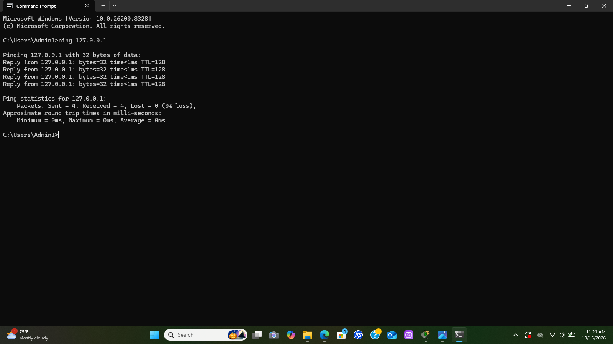
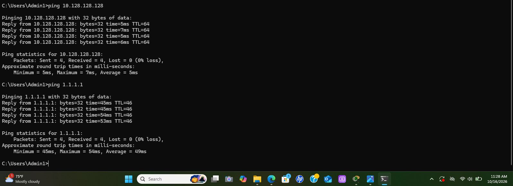
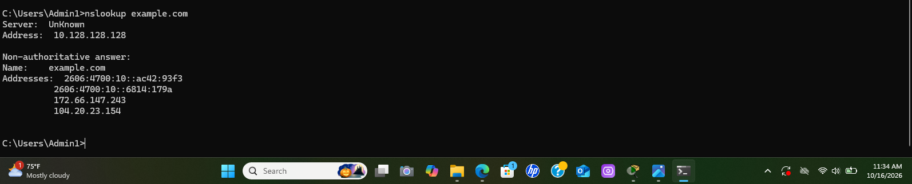

Small Business IT Support Lab

Project Overview

This project demonstrates hands-on Tier 1 help desk troubleshooting in a simulated Windows environment. The objective was to investigate a reported internet connectivity issue, perform network diagnostics, document findings, and organize technical evidence.

Incident Summary

* Ticket ID: HD-001
* Issue: Reported internet connectivity problems
* Category: Network Connectivity
* Status: Investigated

Tools Used

* Windows Command Prompt
* ping
* nslookup
* GitHub

Troubleshooting Steps

1. Tested local TCP/IP connectivity using ping 127.0.0.1.
2. Tested gateway connectivity using ping 10.128.128.128.
3. Tested external IP connectivity using ping 1.1.1.1.
4. Tested DNS name resolution using nslookup example.com.
5. Documented results and captured screenshots of the tests.

Results and Findings

All connectivity tests succeeded during the session. The reported issue could not be reproduced during testing. Results were documented accurately without claiming to resolve an outage that could not be reproduced.

Screenshots

Local Connectivity Test

Gateway and External Connectivity Tests

DNS Resolution Test
## screenshots

### 1. local connectivity test

### 2. gateway and external connectivity tests

### 3. dns resolution test

Key Takeaways

* Practiced systematic Windows network troubleshooting.
* Used command-line tools to test connectivity and DNS resolution.
* Documented findings in a structured help desk workflow.
* Organized technical evidence in GitHub for portfolio presentation.
